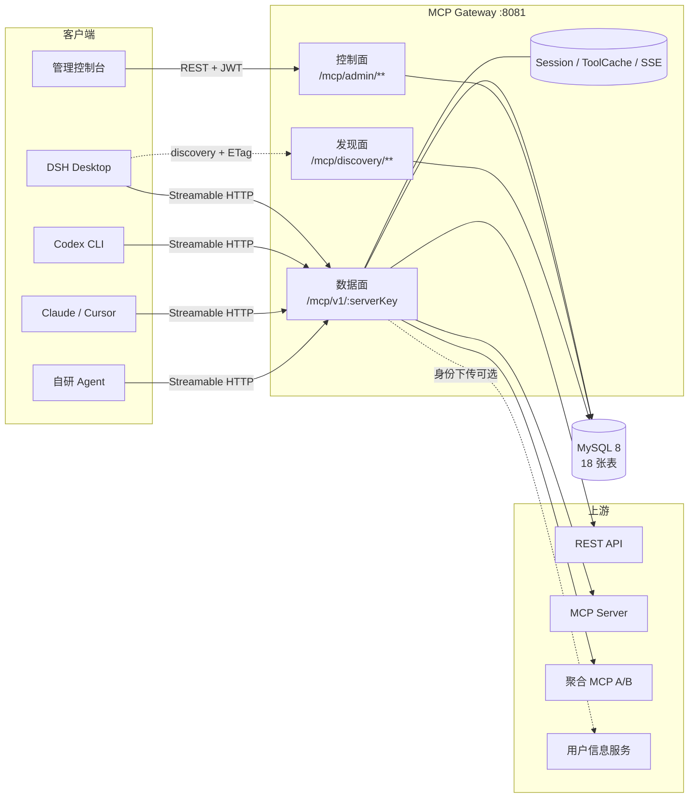
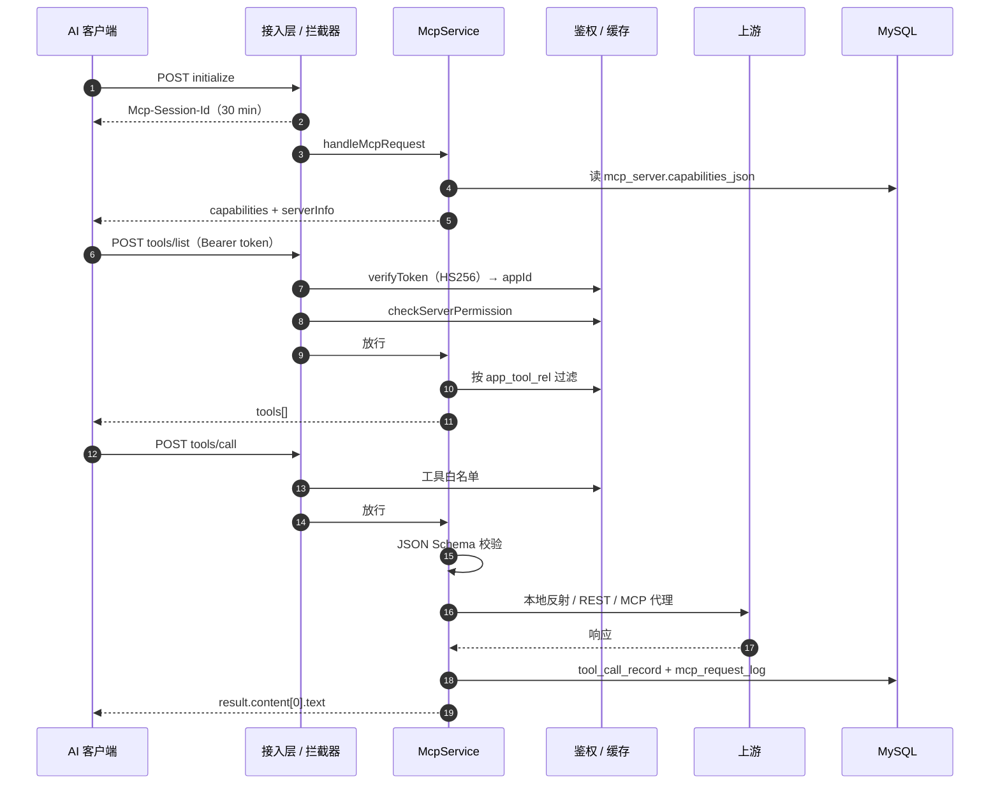
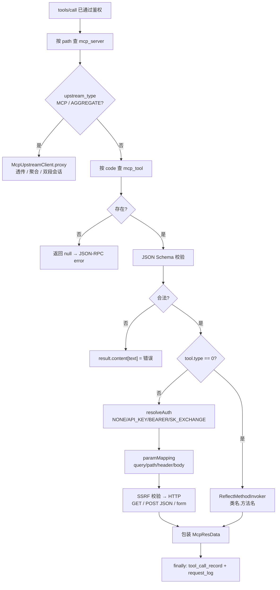
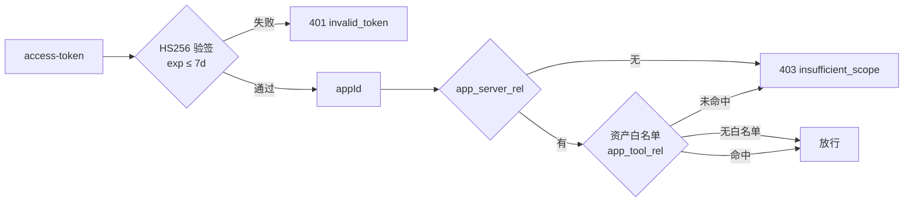
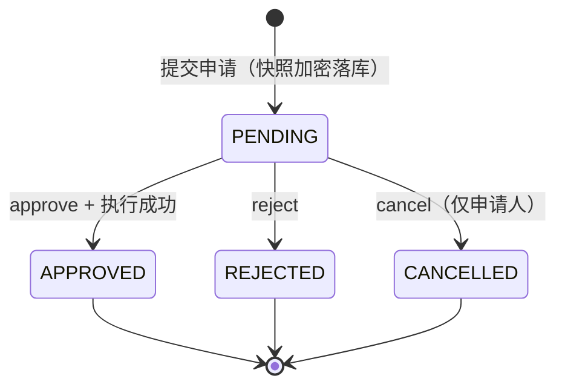
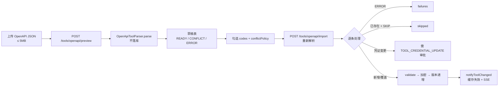
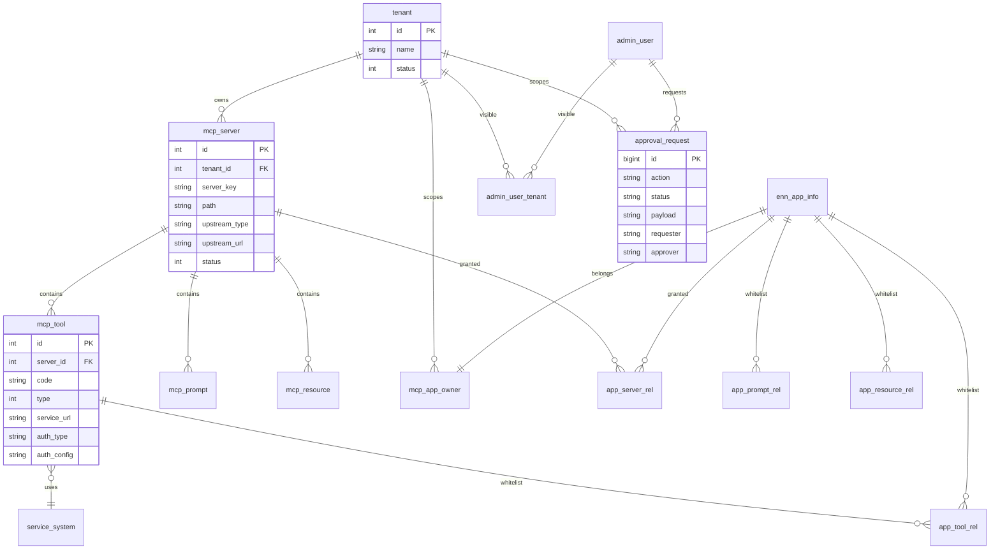
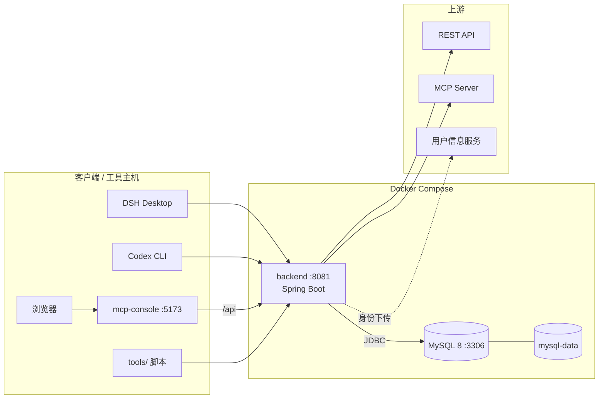
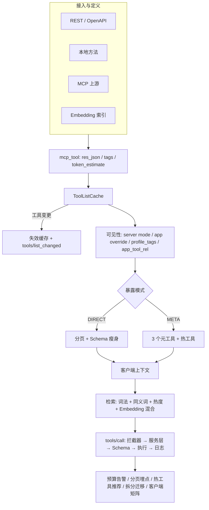

# MCP Gateway · 架构与流程设计总览

> 本文是 [`index.html`](index.html) 图册的**文本版**：用 Mermaid 保存可 diff、可评审的结构，用表格沉淀事实。
> 完整视觉图（12 张矢量 SVG + 1.6x PNG）见 [`index.html`](index.html) 与 [`png/`](png/)。
>
> 基线：仓库 HEAD `79d49ea` · 2026-10 · 范围：`mcp-gateway` / `mcp-console` / `tools` / `docs`

---

## 0. 一分钟读懂

MCP Gateway 把散落在业务系统里的 HTTP 接口与 MCP Server，统一封装成**带多租户、授权、审批、审计与可观测能力**的 MCP 服务。

```
AI 客户端 ── Streamable HTTP ──▶ /mcp/v1/{serverKey}
                                   │ 鉴权 → 会话 → 工具路由 → 参数映射
                                   ├──▶ REST API（HTTP 转发）
                                   ├──▶ 本地工具（反射调用）
                                   ├──▶ MCP Server（透传）
                                   └──▶ 聚合 MCP（{name}__{tool} 路由）
管理控制台 ── REST/JWT ──▶ /mcp/admin/**       （租户 / 资产 / 授权 / 审批 / 日志）
DSH 同步器 ── app JWT ──▶ /mcp/discovery/**    （目录 + revision + ETag）
                                   └── MySQL 8（18 张表）
```

| 维度 | 事实 |
|---|---|
| 后端 | Spring Boot 2.7.18 · JDK 8+ · MyBatis · MySQL 8 · Tomcat · WebFlux WebClient |
| 前端 | React 18 + TypeScript + Vite + shadcn/ui + TanStack Query + Recharts |
| 代码规模 | `src/main` 143 个 Java 文件 / 15,337 行；20 个测试类；`mcp-console/src` 52 个 ts/tsx |
| 数据面 | `/mcp/v1/{serverKey}`：POST JSON-RPC、GET SSE、DELETE 会话 |
| 控制面 | `/mcp/admin/**`：资产 CRUD、授权、审批、OpenAPI 导入、日志、健康、概览 |
| 发现面 | `/mcp/discovery/**`：目录、检索、健康、changes SSE、ETag |
| 存储 | 18 张表：资产 5 + 应用授权 6 + 治理 4 + 运行 3（含 service_system） |
| 部署 | Docker Compose：backend `8081` + MySQL `127.0.0.1:3307`；控制台独立托管 |

---

## 1. 图册索引

| # | 图 | 文件 | 用途 |
|---|---|---|---|
| 01 | 系统全景架构 | [`01-system-architecture.svg`](01-system-architecture.svg) · [PNG](png/01-system-architecture.png) | 汇报、总览、边界说明 |
| 02 | 代码模块与分层 | [`02-module-map.svg`](02-module-map.svg) · [PNG](png/02-module-map.png) | 新人上手、代码评审 |
| 03 | 数据面主链路时序 | [`03-data-plane-sequence.svg`](03-data-plane-sequence.svg) · [PNG](png/03-data-plane-sequence.png) | 联调、问题定位 |
| 04 | tools/call 执行流程 | [`04-tools-call-flow.svg`](04-tools-call-flow.svg) · [PNG](png/04-tools-call-flow.png) | 工具接入、执行器选型 |
| 05 | 三平面鉴权流水线 | [`05-auth-pipeline.svg`](05-auth-pipeline.svg) · [PNG](png/05-auth-pipeline.png) | 安全评审、排障 |
| 06 | 审批流与 RBAC | [`06-approval-flow.svg`](06-approval-flow.svg) · [PNG](png/06-approval-flow.png) | 权限设计、产品评审 |
| 07 | OpenAPI 批量导入 | [`07-openapi-import.svg`](07-openapi-import.svg) · [PNG](png/07-openapi-import.png) | 上游接入、规则确认 |
| 08 | 数据模型（18 表） | [`08-data-model.svg`](08-data-model.svg) · [PNG](png/08-data-model.png) | 数据迁移、SQL 评审 |
| 09 | 部署拓扑 | [`09-deployment.svg`](09-deployment.svg) · [PNG](png/09-deployment.png) | 上线、运维 |
| 10 | 健康度判定（五态） | [`10-health-states.svg`](10-health-states.svg) · [PNG](png/10-health-states.png) | 监控、告警 |
| 11 | 三平面目标架构 | [`11-target-architecture.svg`](11-target-architecture.svg) · [PNG](png/11-target-architecture.png) | 架构演进、P4 规划 |
| 12 | DSH 客户端接入 | [`12-dsh-sync-sequence.svg`](12-dsh-sync-sequence.svg) · [PNG](png/12-dsh-sync-sequence.png) | 客户端接入、token 续期 |

---

## 2. 系统架构



**三条边界**

- **数据面**只做协议与执行：鉴权、会话、工具路由、参数映射、结果包装、日志，不承载管理写操作。
- **控制面**是唯一写入口：资产、授权、审批、OpenAPI 导入；写后通过内部接口 + 集群事件总线（`ClusterEventBus`）通知数据面失效缓存。
- **发现面**只读：目录、健康、changes；必须携带 app token，按应用授权过滤。

---

## 3. 数据面主链路



关键常量：

| 项 | 值 | 位置 |
|---|---|---|
| Session TTL | 30 min | `McpSessionCache` |
| Session 上限 | 20,000 | `mcp.session.max-count` |
| SSE 上限 | 1,000 | `mcp.sse.max-connections` |
| 数据面超时 | 30 s | `McpServiceImpl.DATA_TIMEOUT` |
| 测试连接超时 | 5 s | `TEST_TIMEOUT` |
| tools/list 缓存 | 按 serverId，变更即失效 | `ToolListCache` |
| 日志单字段上限 | 60,000 字符 | `MAX_LOG_TEXT_LENGTH` |

---

## 4. 工具执行



**错误语义**

- 参数校验失败：返回 `result.content[0].text`，不产生 JSON-RPC error，方便模型自纠。
- 工具不存在 / 无权限：在鉴权阶段直接 404 / 403，不泄露资源是否存在。
- 执行异常：JSON-RPC error `-32603`，同时 `tool_call_record.success=0`。

---

## 5. 鉴权与授权

| 入口 | 凭证 | 校验 | 结果 |
|---|---|---|---|
| `/mcp/admin/**`、`/mcp/log/**` | 后台 JWT（Bearer） | 签名 + exp → 角色 → 权限矩阵（默认拒绝） | 401 / 403 / 428 转审批 |
| `/mcp/v1/{serverKey}` | app JWT（`access-token` 或 Bearer） | iss=appId → app_secret 验签 HS256 → exp ≤ 7 天 → Server 授权 → 资产白名单 | 401 / 403 / 404 / 400 |
| `/mcp/discovery/**` | app JWT | 验签 → 可见性过滤 | 401 / 403 |



**身份下传（默认关闭）**

1. 客户端携带 `x-dsh-auth-token`；
2. 网关调用 `/internal/userinfo` 换取 `userId / customerId`；
3. 客编覆盖 `arguments` 中的 `customerId / customer_id / custId`；
4. 校验 app 与 server 同租户，并把身份绑定到 `Mcp-Session-Id`；
5. 向下游签发 60s、按 audience 限定、JWE 加密的内部断言。

> 客户端永远不传客编；模型自报的客编一律不信任。

---

## 6. 审批与 RBAC

角色等级：`SUPER_ADMIN 4 > ADMIN 3 > DEVELOPER 2 > OPERATOR 1 > USER 0`

| 档位 | 含义 | 直接执行 | 发起门槛 | 审批人 | 典型动作 |
|---|---|---|---|---|---|
| L1 | 租户内低风险 | DEVELOPER | DEVELOPER | 不审批 | Tool/Prompt/Resource 增删改、启停、测试 |
| L2 | 租户内高影响 | ADMIN | DEVELOPER | ADMIN | 授权/撤销、Server 创建/删除/连接、下游凭证 |
| L3 | 平台凭证/提权 | SUPER_ADMIN | ADMIN | SUPER_ADMIN | App 创建/重置密钥/删除、用户角色变更 |
| L4 | 平台治理 | SUPER_ADMIN | 不可申请 | 不审批 | 租户创建/更新/删除 |



**硬规则**

1. 审批人 ≠ 申请人，且角色必须严格高于申请人。
2. 按 `payload` 快照执行，避免“申请 A、批 B”。
3. 执行前复核租户、资源存在性、应用与 Server 同租户。
4. 执行失败事务整体回滚，申请保持 `PENDING`。
5. `SELECT ... FOR UPDATE` + `UPDATE ... WHERE status='PENDING'`。
6. `payload` / `result_secret` 均 AES-256-GCM 加密；详情脱敏。

---

## 7. OpenAPI 批量导入



**解析约束**

- 只接受 OpenAPI 3.x；Swagger 2.0 拒绝。
- 运行时只实现 GET / POST；PUT/PATCH/DELETE/HEAD/OPTIONS 标记 ERROR。
- 请求体只支持 `application/json`；multipart 报错。
- `$ref` 仅本地 `#/components/**`；外部引用报错；`allOf` 合并。
- `operationId → code`：非法字符替换、最长 64、同文档重名加后缀、与已有 code 冲突标记 CONFLICT。
- baseUrl 命中 SSRF 策略只 WARN，不阻塞导入。

---

## 8. 数据模型



**完整 18 表**

| 域 | 表 |
|---|---|
| 资产 | `tenant` · `mcp_server` · `mcp_tool` · `mcp_prompt` · `mcp_resource` |
| 配置 | `service_system` |
| 应用与授权 | `enn_app_info` · `mcp_app_owner` · `app_server_rel` · `app_tool_rel` · `app_prompt_rel` · `app_resource_rel` |
| 治理 | `admin_user` · `admin_user_tenant` · `approval_request` · `operation_log` |
| 运行 | `tool_call_record` · `mcp_request_log` |

级联不变量：`app_tool_rel` 只有在对应 `app_server_rel` 已授权时才生效；资产 `status=0` 对所有应用不可见；Server `status=0` 会移除动态路由。

> FK 为**逻辑外键**：DDL 只建普通索引，未声明 `FOREIGN KEY` 约束，引用一致性由应用层与审批执行逻辑保证。

---

## 9. 部署



| 项 | 值 |
|---|---|
| backend 端口 | `8081:8081` |
| MySQL 端口 | `127.0.0.1:3307 → 3306`（仅本机） |
| 数据卷 | `mcp-gateway-mysql-data`（固定卷名） |
| 运行用户 | UID 10001（非 root） |
| 初始化 | `docker/mysql/init.sql`；存量升级 `docs/sql/migration.sql` |
| 启动顺序 | MySQL healthcheck → backend |
| Swagger | 默认关闭，`MCP_SWAGGER_ENABLED=true` 才开放 |

**生产必配**

```bash
MCP_SECURITY_SECRETKEY=<base64 32B>
MCP_ADMIN_JWT_SECRET=<>=32 chars>
MCP_ADMIN_INIT_PASSWORD=<>=8 chars>
SPRING_DATASOURCE_URL=jdbc:mysql://mysql:3306/mcp_gateway?...
SPRING_DATASOURCE_USERNAME=...
SPRING_DATASOURCE_PASSWORD=...
MCP_SWAGGER_ENABLED=false
MCP_SECURITY_ALLOW_PRIVATE_NETWORK=false
```

---

## 10. 演进路线

| 阶段 | 状态 | 内容 |
|---|---|---|
| P0 逻辑解耦 | ✅ 已落地 | `gateway` / `admin` / `discovery` 分包；后续 P2 演进为 `cluster.ClusterEventBus` |
| P1 MCP 代理 | ✅ 已落地 | 透明透传 + AGGREGATE 聚合 + 两段会话 |
| P2 客户端发现 | ✅ 已落地 | `/mcp/discovery/**` + ETag + `tools/list` 元数据 |
| P3 缓存失效分离 | ✅ 已落地 | 控制面不直触缓存，事件化失效 + SSE |
| P4 物理拆分 | ⏳ 规划中 | Admin / Registry / Gateway 三服务 + 多实例 + Redis |

**P4 触发条件**：数据面需要独立扩缩容、多团队并行发布、或单进程成为瓶颈。

**内部通信两方案**

- **A. 共享 DB + 失效通知**：控制面写库，数据面读库 + 本地缓存，写后发失效事件。改动最小，适合当前规模。
- **B. 注册中心 + 事件总线**：控制面写注册中心，注册中心向数据面推送变更。适合多实例、独立扩缩容。

---

## 11. 健康度

| 顺序 | 条件 | 状态 | ok |
|---|---|---|---|
| 1 | `status != 1` | DISABLED | false |
| 2 | 主动探测失败 | DOWN | false |
| 3 | 近 5 分钟样本 ≥ 5 且成功率 < 0.8 | DEGRADED | true |
| 4 | 主动探测成功 | UP | true |
| 5 | 无探测结果且无调用样本 | UNKNOWN | false |

探活方式：MCP 单下游 POST initialize；AGGREGATE 逐个上游；NONE 只校验本地类方法存在，不主动打 REST。
调度：定时 30s + 结果缓存 30s；手动 probe 立即执行；探活同样经过 SSRF 校验。

---

## 12. 源码索引

| 关注点 | 入口 |
|---|---|
| MCP 端点与协议 | `mcp-gateway/src/main/java/com/mcp/transfer/gateway/controller/McpController.java` |
| JSON-RPC 分发 / 工具执行 | `.../gateway/service/impl/McpServiceImpl.java` |
| MCP 代理 / 聚合 | `.../gateway/McpUpstreamClient.java` |
| 动态路由注册 | `.../annotation/McpServerDynamicControllerManager.java` |
| 数据面鉴权 | `.../config/filter/McpAuthInterceptor.java` |
| Session / SSE / 缓存 | `.../config/session/` |
| 控制面 REST | `.../admin/controller/McpAdminController.java` |
| 审批矩阵 | `.../admin/approval/ApprovalPolicy.java` |
| OpenAPI 解析 | `.../admin/service/openapi/OpenApiToolParser.java` |
| 发现面 | `.../discovery/McpDiscoveryService.java` |
| 身份下传 | `.../identity/` |
| 健康探活 | `.../health/` |
| 数据模型 | `db/mysql/init.sql` · `.../entity/` · `.../mapper/` |
| 控制台 | `mcp-console/src/pages/` · `mcp-console/src/lib/api.ts` |
| 接入工具 | `tools/dsh-mcp-sync.py` · `tools/codex-pcb-bridge.sh` · `tools/gen-mcp-app-token.py` |

---

## 13. 已知风险与待办

| 优先级 | 事项 | 状态 / 下一步 |
|---|---|---|
| P0 | 身份下传与上游鉴权（方案 A） | 骨架已落地，默认关闭；待联调用户服务与下游公钥后灰度 |
| P0 | 多实例 Redis 化 | 限流、session、SSE、上游会话均为进程内；多副本前完成 |
| P1 | stdio ↔ Streamable HTTP 桥 | `codex-pcb-bridge.sh` 已提供，按客户端兼容性补齐 |
| P1 | P4 物理拆分 | 边界已文档化，待扩容 / 多团队诉求 |
| P2 | OAuth2 Token Exchange（RFC 8693） | 方案 A 落地后，下游需代表用户再调用时启动 |
| P2 | 身份开启后的探活与聚合上游密钥 | 身份功能启用前完成 |

**残余风险**：应用表全局共享（密钥已脱敏）、SSRF DNS rebinding、控制台 token 存 localStorage、上游 MCP Server 独立凭证未配置、Git 历史需人工清理。详见 [`../安全整改说明.md`](../安全整改说明.md)。

---

## 14. 图表维护

- 矢量源文件位于本目录 `*.svg`，可直接用 Figma / Illustrator / Inkscape 编辑。
- 位图位于 `png/*.png`（1.6x），用于 PPT / Wiki / 即时通讯工具。
- 已导出 [`MCP-Gateway-架构图册.pdf`](MCP-Gateway-架构图册.pdf)（A3 横向，17 页），可直接分发或打印。
- `index.html` 为自包含文件（SVG 内联、无外部依赖），支持左侧目录、点击图放大、打印 / 另存为 PDF。
- 修改架构后，请同步更新：本文件的 Mermaid、`index.html` 中对应的“设计要点”、以及 `docs/` 下的方案文档。

---

## 15. 相关文档

- [MCP 网关架构解耦方案](../MCP网关架构解耦方案.md)
- [MCP 网关多租户改造方案](../MCP网关多租户改造方案.md)
- [身份下传与上游鉴权改造方案](../身份下传与上游鉴权改造方案.md)
- [审批矩阵](../审批矩阵.md)
- [MCP 客户端接入指南](../MCP客户端接入指南.md)
- [DSH 接入](../DSH接入.md)
- [接口调用示例](../接口调用示例.md)
- [安全整改说明](../安全整改说明.md) · [代码审查报告](../代码审查报告.md)
- [待办清单](../待办清单.md)

---

## 13. 2026-10 工具链路优化图册（新增）

> 单独图册：[`tool-optimization.html`](tool-optimization.html) ｜ [`MCP-Gateway-工具链路优化图册.pdf`](MCP-Gateway-工具链路优化图册.pdf)（A3 横向，5 页）

| # | 图 | 文件 | 用途 |
|---|---|---|---|
| 13 | 工具链路优化全景 | [`13-tool-chain-optimized.svg`](13-tool-chain-optimized.svg) · [PDF](13-tool-chain-optimized.pdf) · [PNG](png/13-tool-chain-optimized.png) | 从接入到运营闭环的端到端说明 |
| 14 | 五层治理设计 | [`14-tool-governance-design.svg`](14-tool-governance-design.svg) · [PDF](14-tool-governance-design.pdf) · [PNG](png/14-tool-governance-design.png) | 每层目标、机制、数据落点、验收 |
| 15 | 工具治理架构 | [`15-tool-architecture.svg`](15-tool-architecture.svg) · [PDF](15-tool-architecture.pdf) · [PNG](png/15-tool-architecture.png) | 数据面/控制面/发现面与旁路能力 |
| 16 | 工具链路流程图 | [`16-tool-chain-flow.svg`](16-tool-chain-flow.svg) · [PDF](16-tool-chain-flow.pdf) · [PNG](png/16-tool-chain-flow.png) | 单列垂直流程，适合讲解/贴文档 |

### 13.1 工具链路（Mermaid 文本版）



### 13.2 五层设计要点

| 层 | 机制 | 数据落点 |
|---|---|---|
| 可见性 | Server 模式 + App 覆盖 + 画像标签 + 工具白名单 | `mcp_server` / `app_server_rel` / `app_tool_rel` |
| 暴露面 | DIRECT 分页/瘦身；META 元工具 + 热工具 | `tool_exposure_mode` / `hot_tool_codes` |
| 检索 | CJK 分词 + 同义词 + 热度 + Embedding 混合 | `mcp_tool_embedding` / `tool_call_record` |
| 预算/传输 | visible/returned tokens、阈值、分页门槛 | `mcp_tool.token_estimate` / `mcp.tools.*` |
| 运行/闭环 | 双重鉴权、Schema、SSRF、日志、迁移/探针 | `tool_call_record` / `mcp_request_log` |

### 13.3 架构要点

- **数据面**：`McpController → McpServiceImpl → ToolAccessPolicy / ToolPager / MetaToolFactory / ToolSearchService`。
- **控制面**：`McpAdminController` 负责 exposure、impact、backfill、bulk-move、profile。
- **发现面**：`McpDiscoveryService` 返回 `toolCount / modes / overWarn / revision`，支持 ETag。
- **旁路能力**：`ToolEmbeddingService`、`TokenEstimator`、`ToolPaginationTelemetry`、`ToolBudgetAlerter`，不阻塞主链路。
