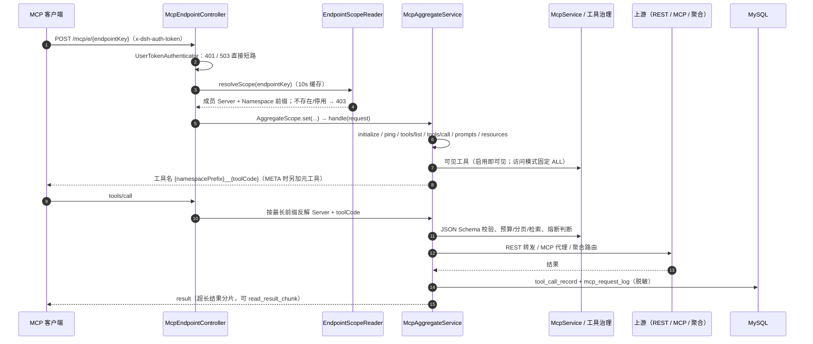
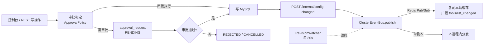
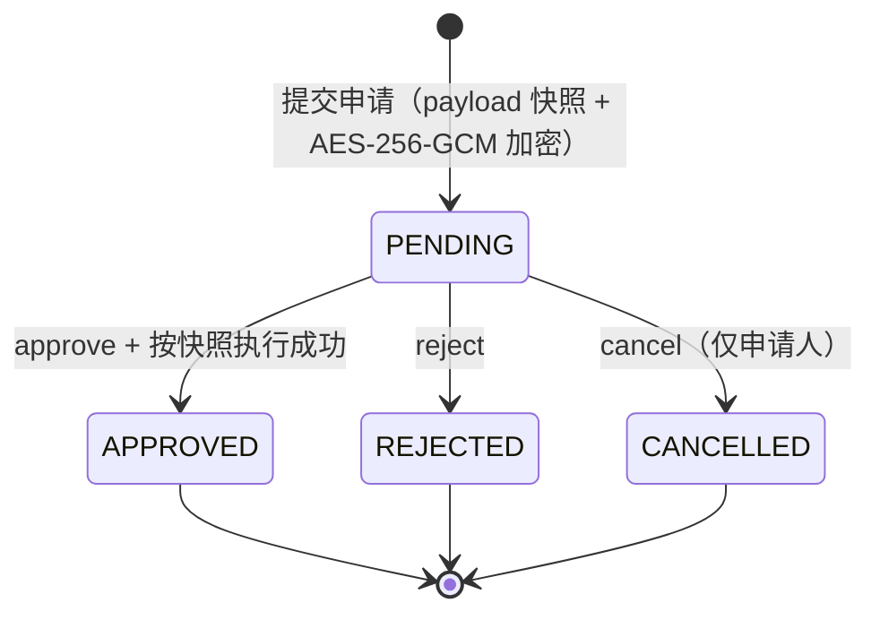
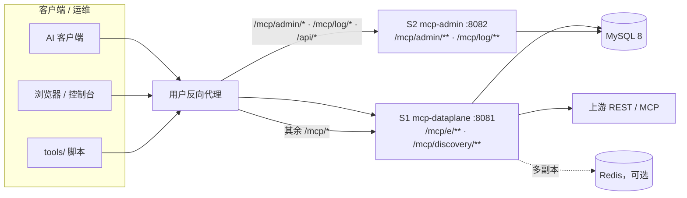

# MCP Gateway · 架构与流程设计总览

> **当前基线（2026-10-26）**：本文是 `docs/architecture/` 图册的**文本版**（用 Mermaid 与表格沉淀可 diff、可评审的结构），内容已对齐当前实现。
> **现行图**：01/02/05/08/09 由 `tools/gen-architecture-atlas.py` 生成，13–16 由 `tools/gen-tool-architecture.py` 生成，均已对齐当前实现；07（OpenAPI 导入流程）与 10（五态健康）为早期图但主线仍成立，索引中标为现行。
> **历史图**：03–04、06、11–12、17 及 `auth/` 下 4 张画的是旧基线（`/mcp/v1`、应用 JWT、应用授权/WHITELIST、容器编排等），**仅用于回溯，不代表现状**。
> 图册的 HTML / 位图 / PDF 导出物为本地生成物，未纳入版本库，本索引只收录 `.svg` / `.mmd` 源文件；事实来源为 `mcp-gateway/` 三模块与 `db/mysql/init.sql`，启动方式以仓库根 [README](../../README.md) 为准。

---

## 0. 一分钟读懂

```text
AI 客户端                 S1 mcp-dataplane :8081              上游
┌────────────┐    ┌──────────────────────────────┐     ┌────────────┐
│ DSH Desktop│    │ POST / GET(SSE) / DELETE     │     │ REST API   │
│ Codex CLI  ├───▶│ /mcp/e/{endpointKey}         ├────▶│ MCP 上游   │
│ Claude/... │    │ /mcp/discovery/**            │     │ 聚合 MCP   │
└────────────┘    │ 鉴权 → 拓扑 → 聚合 → 执行/日志 │     └────────────┘
                  └──────────────┬───────────────┘
                                 │ 读资产/拓扑；写调用日志
   ┌──────────┐   ┌──────────────▼───────────────┐
   │ 控制台    │──▶│ S2 mcp-admin :8082           │──▶ MySQL 8
   │ 静态 SPA  │   │ /mcp/admin/**  /mcp/log/**   │   （可选 Redis）
   └──────────┘   └──────────────────────────────┘
```

| 维度 | 当前事实 |
|---|---|
| 部署单元 | S1 数据面 `:8081`、S2 控制面 `:8082`、S3 控制台（静态构建产物） |
| 后端 | Maven 三模块 `mcp-shared` / `mcp-dataplane` / `mcp-admin`；Spring Boot 3.5.16、JDK 17、MyBatis、MySQL 8、WebClient |
| 客户端唯一入口 | `POST /mcp/e/{endpointKey}`（JSON-RPC）、`GET`（SSE）、`DELETE`（终止会话）；`/mcp/v1/**` 已删除，未注册路径返回 404 |
| 发现面 | `/mcp/discovery/**`，需 `x-dsh-auth-token`；返回 `ETag` / `X-MCP-Revision`，命中返回 `304` |
| 控制面 | `/mcp/admin/**`（租户 / Server / Tool / Prompt / Resource / Namespace / Endpoint / 审批 / 日志）与 `/mcp/log/**` |
| 内部接口 | `/internal/**`，`X-Internal-Token` 校验（未配置时仅回环地址可访问）；反向代理不对外暴露 |
| 认证 | 只认 `x-dsh-auth-token`（`dsh_` / PAT），由 user-center 提供的 `UserTokenStore` 本地校验；应用维度已整体下线（无应用凭据、无应用授权表） |
| 数据模型 | **17 张表**（`db/mysql/init.sql`）：租户/资产 + Namespace/Endpoint 拓扑 + 治理 + 运行日志 |
| 多副本 | `MCP_REDIS_ENABLED=true` 后会话、上游会话、变更事件、探活选主走 Redis；未开启时只能单副本 |
| 部署 | 手工 MySQL 8（`init.sql` + `migrations/*.sql`）+ 两个 jar（`run-local.sh`）+ 反向代理；仓库不提供容器编排 |

---

## 1. 模块与职责

| 模块 | 产物 / 端口 | 职责 | 依赖边界 |
|---|---|---|---|
| `mcp-shared` | 共享 jar | 实体 / Mapper / DTO / 枚举、可见性与工具治理（`exposure`）、身份断言（`identity`）、拓扑读侧（`topology`）、缓存、健康探活、Redis 封装 | **不依赖**两个平面 |
| `mcp-dataplane` | `mcp-dataplane.jar` / `:8081` | 数据面 S1：JSON-RPC 与聚合、Endpoint 接入、上游代理、客户端发现、内部接口、变更事件总线 | 只依赖 `mcp-shared` |
| `mcp-admin` | `mcp-admin.jar` / `:8082` | 控制面 S2：CRUD、审批、OpenAPI 导入、账号与 RBAC、Namespace/Endpoint 写侧、日志查询、健康展示 | 只依赖 `mcp-shared` |
| `mcp-console` | 静态 SPA（`pnpm build`） | 管理界面，只调 `/mcp/admin/**`、`/mcp/log/**` | 前端独立 |
| `tools/` | 脚本 | DSH 同步器、Codex stdio 桥、E2E / 压测 / 图册生成脚本 | — |

**编译期强制边界**：`mcp-shared` 不得依赖数据面或控制面；两个平面互不依赖（跨服务只走 HTTP）。`mcp-admin` 通过 [`/internal/**`](../../mcp-gateway/mcp-dataplane/src/main/java/com/mcp/transfer/gateway/internal/InternalApiController.java) 调用数据面的「测试连通性」「配置变更通知」「健康探活」等能力，不会直连数据面缓存。

---

## 2. 请求主链路

### 2.1 客户端 → Endpoint → 聚合 → 上游



关键规则：

| 规则 | 说明 |
|---|---|
| Endpoint 范围 | `mcp_endpoint` 绑定 1..N 个 `mcp_namespace`，Namespace 再绑定 1..N 个 `mcp_server`；只聚合**启用**的 Endpoint / Namespace / Server |
| 工具命名 | `{namespacePrefix}__{toolCode}`（Endpoint 模式）；超 64 字符时截断并加短哈希（`AggregateNaming`），可反向解析 |
| initialize | 返回聚合后的 `serverInfo`（名称取 Endpoint 名称）；`initialize` 不要求 `Mcp-Session-Id`，其余方法必须校验会话 |
| SSE / 会话 | `GET` 默认 30 分钟超时，全局上限 1000 条、单用户 20 条（可配），超限 429；`Mcp-Session-Id` TTL 30 分钟，`DELETE` 同时清理会话、SSE 与下游会话 |
| 上游类型 | REST 工具（HTTP 转发）、本地工具（反射调用）、MCP 上游（透传）、聚合上游（按 `{name}__{tool}` 路由） |
| 结果治理 | 超过阈值的结果暂存并分片读取（`memory` / `redis`），不把超长文本塞回模型上下文 |

### 2.2 认证流水线

认证顺序：取 `x-dsh-auth-token` → `UserTokenVerifier` → user-center `UserTokenStore.find()` → 写入 `ResolvedIdentity`（userId / userName / customerId / scopes）。任一环节缺失即短路，不会降级为匿名；身份只来自用户 token，不接受 `userId` 请求头、模型自报的客编或任何应用凭据；会话在 `initialize` 时绑定身份，跨副本由 `SessionStore`（内存 / Redis）承载。

| 入口 | 凭证 | 校验 | 失败语义 |
|---|---|---|---|
| `/mcp/e/{endpointKey}` | `x-dsh-auth-token` | 同上 | 缺失/无效 **401**（`-32001`）；Endpoint 不存在/停用 **403**；token store 不可用 **503**（fail-closed） |
| `/mcp/discovery/**` | 同上 | `McpDiscoveryAuthInterceptor` 复用同一认证实现 | 401 / 503；越权访问 Server **403** |
| `/internal/**` | `X-Internal-Token` | 与 `mcp.internal.token` 完全匹配；未配置时只允许回环地址 | 403 |
| `/mcp/admin/**`、`/mcp/log/**` | 后台 JWT（`Authorization: Bearer`） | `AdminJwtUtil` 验签 + `AdminPermissionEvaluator` 权限矩阵（**默认拒绝**） | 401 / 403；需审批的写操作返回业务码 **428** + 审批提示 |

内部接口与后台 JWT 是两条独立通道，互不复用凭证。

### 2.3 控制面写入与缓存失效



- 控制面是**唯一写入口**，数据面只读资产/拓扑并写调用日志；变更事件单副本走进程内总线，多副本走 `RedisClusterEventBus`（频道 `mcp:events:config`）；
- 兜底：`RevisionWatcher` 每 30s 比对 `mcp_server` / `mcp_tool` 的「行数 + 最大 update_time」，发现变化即发 `ALL` 事件，防止事件丢失导致缓存长期不一致。

### 2.4 发现面

`GET /mcp/discovery/servers` 返回当前登录用户可见的 Endpoint 目录（工具数、暴露模式等），带 `ETag` / `X-MCP-Revision`，`If-None-Match` 命中返回 304；另有 `/tools`、`/prompts`、`/resources`、`/servers/{id}/health` 与 `/servers/{id}/changes`（SSE）。管理台预览走 `/mcp/admin/discovery/**`，由后台 JWT 保护，不经过客户端发现鉴权。

### 2.5 审批（Maker-Checker）

角色等级：`SUPER_ADMIN 4 > ADMIN 3 > DEVELOPER 2 > OPERATOR 1 > USER 0`。

| 档位 | 含义 | 直接执行 | 发起门槛 | 审批人 | 典型动作 |
|---|---|---|---|---|---|
| L1 | 租户内低风险写 | DEVELOPER | DEVELOPER | 不审批，只审计 | Tool/Prompt/Resource 增删改、启停、测试、刷新缓存 |
| L2 | 租户内高影响 | ADMIN | DEVELOPER | ADMIN 及以上 | Server 创建/变更连接/删除、Tool 下游凭证变更 |
| L3 | 平台凭证与提权 | SUPER_ADMIN | ADMIN（开发者不可发起） | SUPER_ADMIN | 用户角色变更 |
| L4 | 平台治理 | SUPER_ADMIN | 不可申请 | 不审批（强审计 + 二次确认） | 租户创建/更新/删除 |



硬规则：审批人 ≠ 申请人且角色严格更高；按 `payload` 快照执行；执行前复核租户与资源存在性；执行失败整体回滚并保持 `PENDING`；`SELECT ... FOR UPDATE` + `WHERE status='PENDING'` 保证只处理一次；详情对凭证字段脱敏。矩阵唯一事实来源是 `ApprovalAction` / `ApprovalTier` / `ApprovalPolicy`，完整说明见 [审批矩阵](../审批矩阵.md)。

### 2.6 多副本与会话

| 能力 | 单副本（默认） | 多副本（`MCP_REDIS_ENABLED=true`） |
|---|---|---|
| MCP 会话 | 进程内 Map（30 min TTL） | `mcp:session:{id}` |
| 上游 MCP 会话映射 | 进程内 Map | `mcp:upstream:{gwSession}`（Hash） |
| 变更事件 | 进程内同步回调 | Pub/Sub `mcp:events:config`，每个副本都收到 |
| 探活 | 本副本直接探测 | 租约选主 `mcp:health:leader`（TTL 45s），仅 leader 打上游，其余副本读共享结果 |
| 目录/拓扑缓存 | 进程内（短 TTL） | 仍进程内，靠事件失效 + 30s revision 兜底 |
| SSE 连接 | 进程内 | 仍进程内（servlet 对象不可跨进程）；事件广播后由持有连接的副本推送 |
| 超长结果分片 | `memory` | `MCP_TOOLS_CHUNK_STORE=redis` |

Redis 故障时自动退回进程内实现（告警但不阻断）；控制面仍建议单写副本（登录失败计数、审批并发控制在进程内），详见 [多副本部署](../多副本部署.md)。

---

## 3. 数据模型（17 张表）

| 域 | 表 |
|---|---|
| 租户与资产（7） | `tenant` · `mcp_server` · `mcp_tool` · `mcp_tool_embedding` · `mcp_prompt` · `mcp_resource` · `service_system` |
| 访问拓扑（4） | `mcp_namespace` · `mcp_namespace_server` · `mcp_endpoint` · `mcp_endpoint_namespace` |
| 治理（4） | `admin_user` · `admin_user_tenant` · `approval_request` · `operation_log` |
| 运行（2） | `tool_call_record` · `mcp_request_log` |

级联与归属规则：

- 资产：`tenant` → `mcp_server` → `mcp_tool` / `mcp_prompt` / `mcp_resource`；Server `status=0` 时其资产对数据面不可见；
- 拓扑：Endpoint 绑定 Namespace，Namespace 绑定 Server；工具名 = `{namespace.prefix}__{tool.code}`，`prefix` 全局唯一；
- **拓扑租户归属**：`mcp_namespace` / `mcp_endpoint` 的 `tenant_id` 可空——`NULL` 表示平台级（仅平台超管可管理，可跨租户聚合 Server），非 `NULL` 表示业务方级（只能绑定本租户 Server），见 [`20261025_topology_tenant.sql`](../../db/mysql/migrations/20261025_topology_tenant.sql)；
- 审批：`approval_request` 的 `payload` 为加密快照，`result_secret` 历史字段已下线；FK 均为**逻辑外键**，DDL 只建普通索引，一致性由应用层与审批执行保证。

新装环境执行 [`db/mysql/init.sql`](../../db/mysql/init.sql)，存量环境按文件名顺序执行 [`db/mysql/migrations/`](../../db/mysql/migrations/) 下的增量脚本；删除历史应用表/字段的脚本在 [`docs/sql/`](../sql/)，需人工确认后执行。

---

## 4. 工具治理（Endpoint 级）

| 层 | 机制 | 关键实现 |
|---|---|---|
| 可见性 | 启用即可见（无应用授权）；Endpoint 范围再收窄 | `ToolAccessPolicy`、`EndpointScopeReader` |
| 访问模式 | 固定 `ALL`（写入侧强制，前端不再提供选择） | `ToolExposureModes.ACCESS_ALL` |
| 暴露面 | Endpoint 级 META 合并：DIRECT 出全量工具，META 出热工具 + 一套端点级元工具 | `McpAggregateService`、`MetaToolFactory`，见 [Endpoint 层 META 合并](../Endpoint层META合并设计.md) |
| 元工具 / Schema | `search_tools` / `get_tool_schema` / `call_tool` / `read_result_chunk`（作用域整个 Endpoint）；`get_tool_schema` 支持 `compact` / `full` | `MetaToolFactory`、`ToolSchemaCompactor`；`mcp.tools.meta-enabled` 应急回退 DIRECT |
| 检索 | `CATALOG` / `KEYWORD` / `BM25` / `VECTOR` / `HYBRID`（RRF 融合）；`AUTO` 按有无 query 与 embedding 自动选择，无 embedding 自动降级 | `ToolSearchService`、`ToolEmbeddingService` |
| 分页 | MCP 标准 `nextCursor`；低于阈值整包返回，避免不跟随游标的客户端丢工具 | `ToolPager`、`ToolExposureProperties` |
| 预算 | visible/returned token 估算、告警与硬阈值（不阻断调用）、schema 瘦身 | `TokenEstimator`、`ToolBudget`、`ToolBudgetAlerter`、`ToolSchemaTrimmer` |
| 结果分片 | 超长结果暂存 + `read_result_chunk` 分段读取（`memory` / `redis`） | `ToolResultStore` |
| 熔断 | 下游连续失败后短路，避免每轮对话都等超时 | `UpstreamCircuitBreaker`（按 Server，进程内） |
| Prompt/Resource | 轻量治理：分页、内容上限、可见性同工具 | `AssetPager`、`AssetContentLimiter`、`AssetAccessPolicy`，见 [Prompt 与 Resource 治理](../Prompt与Resource治理.md) |

档位：`MCP_TOOLS_PROFILE=default/compact/large` 预设；其它阈值有安全默认值，可用单项环境变量或 `--mcp.tools.*` 覆盖。

---

## 5. 身份下传（下游鉴权）

| 维度 | 行为 |
|---|---|
| 模式 | `MCP_IDENTITY_MODE=OFF/OPTIONAL/REQUIRED`，Server 可用 `identity_mode` 覆盖（`INHERIT` 沿用全局） |
| OPTIONAL | 缺用户/客编/下游公钥或签发失败时告警并降级为不下传，不阻断调用 |
| REQUIRED | 任一条件不满足直接抛 `IdentityRequiredException`，数据面返回 JSON-RPC **-32003**，不转发下游 |
| 令牌 / 透传 | `MCP_IDENTITY_TOKEN_FORMAT=JWS`（只签名）或 `JWE`（需下游公钥），短 TTL、按 audience 限定；`MCP_IDENTITY_FORWARD_USER_TOKEN` 默认 `false`，仅可信下游开启 |
| 探活 | 使用独立 service 断言 `sub=gateway-health-probe, scope=[health]`，不要求客编，避免下游把探活判为未授权 |

统一判定点：[`IdentityAssertionResolver`](../../mcp-gateway/mcp-shared/src/main/java/com/mcp/transfer/identity/IdentityAssertionResolver.java)；下游验签可用 `McpIdentityVerifier` / `GatewayOriginVerifier`。方案与联调步骤见 [身份下传与上游鉴权改造方案](../身份下传与上游鉴权改造方案.md)。

---

## 6. 部署（交付仓库形态）



部署步骤：

1. **MySQL 8**（手工安装，仓库不提供容器编排）：`mysql -uroot -p < db/mysql/init.sql`，再按文件名顺序执行 `db/mysql/migrations/*.sql`；
2. **配置**：`cd mcp-gateway && cp .env.example .env`，至少填 `MCP_SECURITY_SECRETKEY`、`MCP_ADMIN_JWT_SECRET`、`MCP_ADMIN_INIT_PASSWORD`、`MCP_INTERNAL_TOKEN`、`MCP_PUBLIC_BASE_URL`；
3. **构建与启动**：`mvn -DskipTests package`，再 `./run-local.sh both`（或分别 `dataplane` / `admin`）；两个 jar 用 `SERVER_PORT` 选端口，角色由启动哪个 jar 决定；
4. **控制台**：`mcp-console` 执行 `pnpm build`，静态产物交给用户自己的反向代理托管，只调 `/mcp/admin/**`、`/mcp/log/**`；`/internal/**` 不对外暴露，单副本无需 Redis，多副本设置 `MCP_REDIS_ENABLED=true` + `MCP_REDIS_URL`；
5. **首次启动**：`AdminBootstrap` 创建超管 `admin`，密码取 `MCP_ADMIN_INIT_PASSWORD`；Swagger 默认关闭，`MCP_SWAGGER_ENABLED=true` 才开放。

配置分三层（运维环境变量 / Spring 高级属性 / 资源层 DB 配置），完整清单与优先级见 [配置说明](../配置说明.md)。生产必须替换默认密钥，内网访问需显式开启 `MCP_SECURITY_ALLOW_PRIVATE_NETWORK`。

---

## 7. 模块与源码索引

| 关注点 | 位置 |
|---|---|
| 数据面入口（Endpoint） | [`McpEndpointController`](../../mcp-gateway/mcp-dataplane/src/main/java/com/mcp/transfer/access/McpEndpointController.java) · [`EndpointPaths`](../../mcp-gateway/mcp-shared/src/main/java/com/mcp/transfer/topology/EndpointPaths.java) |
| 聚合与工具命名 | [`McpAggregateService`](../../mcp-gateway/mcp-dataplane/src/main/java/com/mcp/transfer/gateway/aggregate/McpAggregateService.java) · [`AggregateNaming`](../../mcp-gateway/mcp-dataplane/src/main/java/com/mcp/transfer/gateway/aggregate/AggregateNaming.java) |
| 上游代理 | [`McpUpstreamClient`](../../mcp-gateway/mcp-dataplane/src/main/java/com/mcp/transfer/gateway/McpUpstreamClient.java) · [`McpService`](../../mcp-gateway/mcp-dataplane/src/main/java/com/mcp/transfer/gateway/service/McpService.java) |
| 认证与会话 | [`UserTokenAuthenticator`](../../mcp-gateway/mcp-dataplane/src/main/java/com/mcp/transfer/config/filter/UserTokenAuthenticator.java) · [`McpSessionCache`](../../mcp-gateway/mcp-dataplane/src/main/java/com/mcp/transfer/config/session/McpSessionCache.java) · [`SseEmitterRegistry`](../../mcp-gateway/mcp-dataplane/src/main/java/com/mcp/transfer/config/session/SseEmitterRegistry.java) |
| 拓扑解析（只读） | [`EndpointScopeReader`](../../mcp-gateway/mcp-shared/src/main/java/com/mcp/transfer/topology/EndpointScopeReader.java) · [`EndpointScope`](../../mcp-gateway/mcp-shared/src/main/java/com/mcp/transfer/topology/EndpointScope.java) |
| 工具治理 | [`ToolAccessPolicy`](../../mcp-gateway/mcp-shared/src/main/java/com/mcp/transfer/exposure/ToolAccessPolicy.java) · [`ToolPager`](../../mcp-gateway/mcp-shared/src/main/java/com/mcp/transfer/exposure/ToolPager.java) · [`ToolSearchService`](../../mcp-gateway/mcp-shared/src/main/java/com/mcp/transfer/exposure/ToolSearchService.java) · [`MetaToolFactory`](../../mcp-gateway/mcp-shared/src/main/java/com/mcp/transfer/exposure/MetaToolFactory.java) |
| 多副本 | [`RedisClusterEventBus`](../../mcp-gateway/mcp-dataplane/src/main/java/com/mcp/transfer/cluster/RedisClusterEventBus.java) · [`RevisionWatcher`](../../mcp-gateway/mcp-dataplane/src/main/java/com/mcp/transfer/cluster/RevisionWatcher.java) · [`RedisProbeLeader`](../../mcp-gateway/mcp-shared/src/main/java/com/mcp/transfer/health/RedisProbeLeader.java) |
| 健康与熔断 | [`McpServerHealthService`](../../mcp-gateway/mcp-shared/src/main/java/com/mcp/transfer/health/McpServerHealthService.java) · [`UpstreamCircuitBreaker`](../../mcp-gateway/mcp-shared/src/main/java/com/mcp/transfer/health/UpstreamCircuitBreaker.java) |
| 身份下传 | [`IdentityAssertionResolver`](../../mcp-gateway/mcp-shared/src/main/java/com/mcp/transfer/identity/IdentityAssertionResolver.java) · [`InternalIdentityTokenService`](../../mcp-gateway/mcp-shared/src/main/java/com/mcp/transfer/identity/InternalIdentityTokenService.java) |
| 客户端发现 | [`McpDiscoveryController`](../../mcp-gateway/mcp-dataplane/src/main/java/com/mcp/transfer/discovery/McpDiscoveryController.java) · [`McpDiscoveryService`](../../mcp-gateway/mcp-shared/src/main/java/com/mcp/transfer/catalog/McpDiscoveryService.java) |
| 管理面 REST | [`McpAdminController`](../../mcp-gateway/mcp-admin/src/main/java/com/mcp/transfer/admin/controller/McpAdminController.java) · [`McpAdminAccessController`](../../mcp-gateway/mcp-admin/src/main/java/com/mcp/transfer/admin/controller/McpAdminAccessController.java) |
| 审批与 RBAC | [`ApprovalPolicy`](../../mcp-gateway/mcp-admin/src/main/java/com/mcp/transfer/admin/approval/ApprovalPolicy.java) · [`AdminPermissionEvaluator`](../../mcp-gateway/mcp-admin/src/main/java/com/mcp/transfer/admin/security/AdminPermissionEvaluator.java) |
| OpenAPI 导入 / 内部接口 | [`OpenApiToolParser`](../../mcp-gateway/mcp-admin/src/main/java/com/mcp/transfer/admin/service/openapi/OpenApiToolParser.java) · [`InternalApiController`](../../mcp-gateway/mcp-dataplane/src/main/java/com/mcp/transfer/gateway/internal/InternalApiController.java) |
| 数据模型 | [`init.sql`](../../db/mysql/init.sql) · [`migrations/`](../../db/mysql/migrations/) · [`entity/`](../../mcp-gateway/mcp-shared/src/main/java/com/mcp/transfer/shared/entity/) |
| 构建与启动 | [`pom.xml`](../../mcp-gateway/pom.xml) · [`run-local.sh`](../../mcp-gateway/run-local.sh) · [`.env.example`](../../mcp-gateway/.env.example) |
| 控制台 | [`api.ts`](../../mcp-console/src/lib/api.ts) · [`pages/`](../../mcp-console/src/pages/) |
| 工具与图册 | [`dsh-mcp-sync.py`](../../tools/dsh-mcp-sync.py) · [`codex-pcb-bridge.sh`](../../tools/codex-pcb-bridge.sh) · [`full-e2e-test.py`](../../tools/full-e2e-test.py) · [`gen-tool-architecture.py`](../../tools/gen-tool-architecture.py) |

---

## 8. 图册索引

> 状态口径：`现行` = 由生成脚本按当前实现产出（01/02/05/08/09/13–16）或主线仍成立（07/10）；`历史` = 旧基线图，**仅作历史参考**（含应用授权 / `WHITELIST` / 容器编排等已移除设计）。
> 生成脚本：`tools/gen-architecture-atlas.py`（01/02/05/08/09）与 `tools/gen-tool-architecture.py`（13–16）；03/04/06/11/12/17 与 `auth/` 系列暂无生成器。

| # | 主题 | 文件 | 状态 | 说明 |
|---|---|---|---|---|
| 01 | 系统架构总览 | [01-system-architecture.svg](01-system-architecture.svg) | 现行 | 客户端 → 反向代理 → 数据面/控制面；共享内核；17 张表；无容器编排 |
| 02 | 代码模块与依赖边界 | [02-module-map.svg](02-module-map.svg) | 现行 | Maven 三模块包结构、编译期强制边界、非 Maven 模块 |
| 03 | 数据面主链路时序 | [03-data-plane-sequence.svg](03-data-plane-sequence.svg) | 历史（仍含 /mcp/v1 等旧内容） | `/mcp/v1`、`appId` / `app_secret`、应用授权过滤 |
| 04 | tools/call 执行流程 | [04-tools-call-flow.svg](04-tools-call-flow.svg) | 历史（仍含 /mcp/v1 等旧内容） | 按 `path` 解析 Server、`X-MCP-App-Id` 等旧头 |
| 05 | 认证与身份链路 | [05-auth-pipeline.svg](05-auth-pipeline.svg) | 现行 | 用户 token 链路（401/403/503）、身份下传（OFF/OPTIONAL/REQUIRED）、后台 JWT |
| 06 | 审批流与 RBAC | [06-approval-flow.svg](06-approval-flow.svg) | 历史（仍含 /mcp/v1 等旧内容） | 含应用建删/重置、`GRANT_*` 等已移除动作 |
| 07 | OpenAPI 批量导入 | [07-openapi-import.svg](07-openapi-import.svg) | 现行（局部文案旧） | 预览 → 勾选 → 导入流程与当前一致；图中缓存失效组件已由 `ClusterEventBus` 承担 |
| 08 | 数据模型 | [08-data-model.svg](08-data-model.svg) | 现行 | 17 张表分域、拓扑租户归属、关键字段 |
| 09 | 部署拓扑 | [09-deployment.svg](09-deployment.svg) | 现行 | 手工 MySQL + 两个 jar + 反向代理 + 可选 Redis；部署步骤与自检 |
| 10 | 健康度判定（五态） | [10-health-states.svg](10-health-states.svg) | 现行 | 五态判定与探活方式未变 |
| 11 | 三平面目标架构 | [11-target-architecture.svg](11-target-architecture.svg) | 历史（仍含 /mcp/v1 等旧内容） | 目标架构图仍标 `/mcp/v1` 入口 |
| 12 | DSH 客户端接入 | [12-dsh-sync-sequence.svg](12-dsh-sync-sequence.svg) | 历史（仍含 /mcp/v1 等旧内容） | `/mcp/v1`、`appId` |
| 13 | 工具链路全貌 | [13-tool-chain-optimized.svg](13-tool-chain-optimized.svg) | 现行 | 接入 → 定义/缓存 → 可见性 → 暴露面 → 检索 → 调用 → 运营闭环 |
| 14 | 五层治理设计 | [14-tool-governance-design.svg](14-tool-governance-design.svg) | 现行 | 可见性 / 暴露面 / 检索 / 预算传输 / 运行闭环五层 |
| 15 | 工具治理架构 | [15-tool-architecture.svg](15-tool-architecture.svg) | 现行 | 两进程 + 共享内核、横切能力、17 表、上游/旁路服务 |
| 16 | 工具链路流程图 | [16-tool-chain-flow.svg](16-tool-chain-flow.svg) | 现行 | 八阶段流程：启用即可见、按需暴露、失败可降级 |
| 17 | 会话到工具调用流程 | [17-session-to-toolcall-flow.svg](17-session-to-toolcall-flow.svg) | 历史（仍含 /mcp/v1 等旧内容） | `/mcp/v1` |
| auth 17 | 鉴权端到端时序 | [auth/17-auth-e2e-sequence.svg](auth/17-auth-e2e-sequence.svg) · [mmd](auth/17-auth-e2e-sequence.mmd) | 历史（仍含 /mcp/v1 等旧内容） | 应用 JWT、`app_server_rel`、`/mcp/v1` |
| auth 17b | 鉴权调用精简版 | [auth/17b-auth-call-compact.svg](auth/17b-auth-call-compact.svg) · [mmd](auth/17b-auth-call-compact.mmd) | 历史（仍含 /mcp/v1 等旧内容） | 应用 JWT、`/internal/userinfo` |
| auth 18 | 鉴权判定流程 | [auth/18-auth-decision.svg](auth/18-auth-decision.svg) · [mmd](auth/18-auth-decision.mmd) | 历史（仍含 /mcp/v1 等旧内容） | `/mcp/v1`、应用 JWT |
| auth 19 | 鉴权架构 | [auth/19-auth-architecture.svg](auth/19-auth-architecture.svg) · [mmd](auth/19-auth-architecture.mmd) | 历史（仍含 /mcp/v1 等旧内容） | `McpAuthInterceptor`、双凭据（应用 JWT + 用户 token） |

维护约定：01/02/05/08/09 用 `python3 tools/gen-architecture-atlas.py` 重新生成，13–16 用 `python3 tools/gen-tool-architecture.py` 重新生成（两脚本只输出 SVG，不修改本文件）。
尚未重绘：03（数据面主链路时序）、04（tools/call 执行流程）、06（审批流与 RBAC）、11（目标架构）、12（DSH 接入）、17（会话到工具调用）与 `auth/` 系列 —— 没有生成脚本，需手工重绘或先补生成器；在重绘前保持「历史」标注。改动架构后请同步本文件对应章节与相关方案文档。

---

## 9. 演进状态（P0–P5）

| 阶段 | 状态 | 当前实现 |
|---|---|---|
| P0 逻辑解耦 | ✅ 已落地 | 按 `gateway` / `access` / `discovery` / `admin` 分包，共享内核独立 |
| P1 MCP 代理与聚合 | ✅ 已落地 | 透传 + 聚合上游 + 两段会话映射 + Endpoint 级聚合 |
| P2 客户端发现 | ✅ 已落地 | `/mcp/discovery/**` + `ETag` / 304 + revision |
| P3 缓存失效分离 | ✅ 已落地 | 控制面不直触数据面缓存 → `/internal/config-changed` → `ClusterEventBus` + SSE 广播 |
| P4 物理拆分 | ✅ 已落地 | 3 个 Maven 模块 → 2 个进程（S1/S2）+ 共享内核，编译期强制边界；控制面↔数据面只走 HTTP |
| P5 多副本 | ✅ 已落地 | Redis 会话 / 上游会话 / 事件总线 / 探活选主；30s revision 兜底；SSE 按副本广播 |

未完成事项统一收敛到 [待办清单](../待办清单.md)，主要有：user-center 真实 `UserTokenStore` 联调（未接入前受保护请求 503）、身份下传的生产密钥/公钥配置与下游验签联调、控制面水平扩展（登录计数与审批锁外置）、OAuth2 Token Exchange、存量库清理脚本执行、安全响应头。

---

## 10. 相关文档

- [仓库根 README（特性 / 快速开始 / 接口速览）](../../README.md)
- [配置说明（三层配置与变量清单）](../配置说明.md)
- [服务拆分分析](../服务拆分分析.md) · [数据面多副本部署](../多副本部署.md)
- [Endpoint 统一接入](../Endpoint统一接入.md) · [Endpoint 层 META 合并设计](../Endpoint层META合并设计.md)
- [工具规模治理](../工具规模治理.md) · [Prompt 与 Resource 治理](../Prompt与Resource治理.md)
- [身份下传与上游鉴权改造方案](../身份下传与上游鉴权改造方案.md)
- [审批矩阵](../审批矩阵.md) · [安全整改说明](../安全整改说明.md)
- [MCP 客户端接入指南](../MCP客户端接入指南.md) · [客户端兼容矩阵](../客户端兼容矩阵.md) · [DSH 接入](../DSH接入.md) · [接口调用示例](../接口调用示例.md)
- [架构解耦方案](../MCP网关架构解耦方案.md) · [多租户改造方案](../MCP网关多租户改造方案.md) · [工具链路优化实施报告](../工具链路优化实施报告.md) · [待办清单](../待办清单.md)
